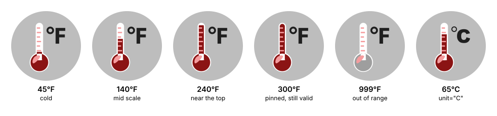
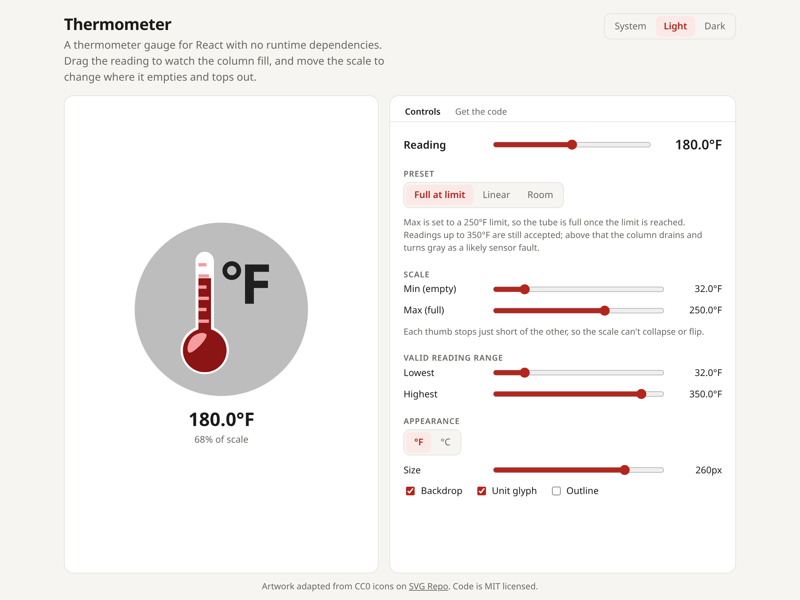

<p align="center">
  
</p>

# Thermometer

A temperature gauge for React in a single file, with no dependencies besides React. The demo page lets you tune a configuration with sliders and then copy exactly the code that runs it.

<picture>
  <source media="(prefers-color-scheme: dark)" srcset="docs/demo-dark.png">
  
</picture>

## Use it in your project

The whole component is [`src/thermometer/Thermometer.tsx`](./src/thermometer/Thermometer.tsx). Copy that file into your project, or use **Download Thermometer.tsx** on the demo page. [Its README](./src/thermometer/README.md) covers the props, theming, and how it handles bad input.

```tsx
import { Thermometer } from './components/Thermometer';

<Thermometer value={reading} min={32} max={250} validRange={{ min: 32, max: 350 }} />
```

## Develop

Requires [Bun](https://bun.sh).

```bash
bun install
bun run dev      # demo at http://localhost:5173
bun run test     # unit tests, including hostile-prop rendering
bun run build    # type-check, then production build to dist/
bun run lint
bun run hero     # regenerate docs/hero.svg after changing the component's look
```

`docs/demo-light.png` and `docs/demo-dark.png` are screenshots of the demo page, so retake both when the page's UI changes.

```
src/
  thermometer/     the component, shipped as-is to users
    Thermometer.tsx
    README.md
  demo/            demo-only code
    CodePanel.tsx  copy/download panel; reads the component via ?raw imports
    render.ts      Shiki highlighting + marked README rendering, in its own chunk
  App.tsx          the demo page
tests/             bun test suites
scripts/hero.tsx   regenerates docs/hero.svg from the component
docs/              README images
art/source/        unmodified source icons
```

The code panel imports the component and its README with Vite's `?raw` suffix, so what a user copies or downloads is always byte-for-byte the code the demo renders. The usage snippet spells out every prop, so it reproduces the demo's settings exactly.

The demo depends on [Shiki](https://shiki.style) for highlighting and [marked](https://marked.js.org) for rendering the README. Both load in a separate chunk that starts downloading with the page, so they never touch the component and don't delay the gauge's first paint.

## Guardrails

Nothing a user does should leave the gauge in a broken state, either in the demo or through props:

- **Demo controls are constrained.** The scale's min and max thumbs stop 1°F short of each other, so the scale can't collapse or flip. The valid-range thumbs behave the same way.
- **The component sanitizes every prop.** It swaps a reversed range and fills non-finite bounds from the defaults. A zero-width scale becomes a step, and a bad `size` or unknown `unit` falls back to its default.
- **It fits narrow containers.** The SVG shrinks to fit a container narrower than `size` instead of overflowing it.
- **The tests cover bad input.** `tests/thermometer.test.tsx` renders the component with each kind of bad prop and checks that the result is a valid SVG with no `NaN`, `Infinity`, or `undefined` in it.

## Credits

The artwork is adapted from public-domain (CC0) icons on [SVG Repo](https://www.svgrepo.com). See [ATTRIBUTION.md](./ATTRIBUTION.md). The code is released under the [MIT license](./LICENSE).
